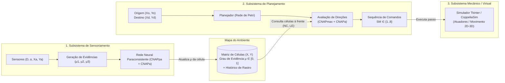

# 🤖 IC-Robo — Navegação e Controle de Robôs Móveis Autônomos com Lógica Paraconsistente

Repositório oficial de catalogação, documentação teórica e códigos de simulação da **Iniciação Científica (IC)** sobre **Sistemas Inteligentes Baseados na Lógica Paraconsistente Anotada Evidencial ($E\tau$) para Controle e Navegação de Robôs Móveis Autônomos**, orientado pelo **Prof. Dr. Cláudio Rodrigo Torres**.

---

## 🎯 Sobre o Projeto

Robôs móveis autônomos dependem de sensores para perceber o ambiente ao seu redor e tomar decisões de navegação. Em cenários reais, as leituras de sensores estão sujeitas a ruídos, reflexos, falta de informação (**paracompleteza**) ou leituras conflitantes entre sensores (**inconsistência / contradição**).

Enquanto sistemas baseados na lógica clássica binária podem falhar ou exigir simplificações complexas diante de dados contraditórios, este projeto utiliza a **Lógica Paraconsistente Anotada Evidencial ($E\tau$)** e **Redes Neurais Artificiais Paraconsistentes (RNAP)** para tratar incertezas e contradições de forma matemática e não-trivial, dividindo a arquitetura do robô em três subsistemas:

1. **Subsistema de Sensoriamento:** Mapeia o ambiente dividido em **células** no plano cartesiano e calcula, por meio de Células Neurais Artificiais Paraconsistentes (`CNAPpa` e `CNAPa`), o grau de evidência favorável ($\mu \in [0, 1]$) da proposição *"Existe obstáculo na célula"*.
2. **Subsistema de Planejamento:** Modela a grade do ambiente com base em **Redes de Petri** e utiliza redes neurais paraconsistentes (`CNAPmax` e `CNAPa`) para gerar uma sequência de comandos em **8 direções** que leva o robô da posição de origem $(X_o, Y_o)$ até o destino $(X_d, Y_d)$ desviando de obstáculos.
3. **Subsistema Mecânico / Simulação Virtual:** Execução visual e cinemática dos movimentos planejados em ambiente virtual (**Python / Tkinter** e **CoppeliaSim Edu**), inspirado na família de robôs autônomos **Emmy I, Emmy II e Emmy III**.

---

## 📂 Estrutura do Repositório e Catálogo de Arquivos

Todos os materiais referentes ao robô foram organizados na estrutura abaixo:

```text
IC-Robo/
├── README.md                                                     # Catálogo geral e documentação principal do repositório
├── .gitignore                                                    # Arquivos ignorados pelo Git
├── src/
│   └── Interface_PlanejadorRobô2.py                              # Simulador gráfico 2D (Tkinter) do planejador no plano cartesiano
└── docs/
    ├── Resumo_Teorico_e_Glossario.md                             # Síntese teórica, glossário técnico e arquitetura POO do robô
    ├── fundamentacao-teorica/
    │   ├── Dissertacao_Mestrado_Claudio_Torres_2004_Emmy_II.pdf  # Dissertação de Mestrado (Robô Emmy II e controlador Paracontrol)
    │   └── Tese_Doutorado_Claudio_Torres_2010_Emmy_III.pdf       # Tese de Doutorado (Sensoriamento, Planejamento e RNAP)
    └── notas-estudo/
        ├── Logica_Paraconsistente.pdf                            # Resumo ilustrado sobre Lógica Paraconsistente (μ e λ) no robô
        ├── Celulas_Neurais_Artificiais_Paraconsistentes.pdf      # Notas sobre CNAPa, CNAPpa, CNAPmax e ligação com POO
        ├── Movimento_Robo.pdf                                    # Estudo de variáveis (Xo, Yo, Xd, Yd) e movimentos no plano cartesiano
        └── Sequencia_de_Comandos.pdf                             # Definição dos 8 comandos direcionais, células e sequências
```

---

## 📑 Detalhamento do Catálogo

### 1. Código-Fonte e Simulação (`src/`)

| Arquivo | Descrição Técnica |
| :--- | :--- |
| [`src/Interface_PlanejadorRobô2.py`](src/Interface_PlanejadorRobô2.py) | **Simulador de Robô no Plano Cartesiano (Python / Tkinter):** Interface gráfica interativa e responsiva com grade cartesiana de $-10$ a $+10$. Recebe as coordenadas de origem $(X_o, Y_o)$ e destino $(X_d, Y_d)$, calcula a sequência de comandos nas **8 direções** (`gerar_sequencia`), anima o deslocamento passo a passo do robô e desenha o rastro percorrido sobre as células disponíveis. |

### 2. Fundamentação Teórica (`docs/fundamentacao-teorica/`)

| Arquivo | Autor / Ano | Conteúdo Principal Relevante ao Robô |
| :--- | :--- | :--- |
| [`Dissertacao_Mestrado_Claudio_Torres_2004_Emmy_II.pdf`](docs/fundamentacao-teorica/Dissertacao_Mestrado_Claudio_Torres_2004_Emmy_II.pdf) | Cláudio Rodrigo Torres (UNIFEI, 2004) | *Sistema Inteligente Paraconsistente para Controle de Robôs Móveis Autônomos*. Apresenta a Lógica Paraconsistente Anotada Evidencial $E\tau$, o algoritmo **Para-analisador**, o controlador **Paracontrol** de 6 estados lógicos (`V`, `F`, `⊥`, `T`, `QF→⊥`, `QF→T`), controle de velocidade, movimentos retrógrados, esquemas eletrônicos (89C52 + sensores Polaroid 6500 + ponte MOSFET) e o código Assembly 8051 do robô **Emmy II** (Anexo I). |
| [`Tese_Doutorado_Claudio_Torres_2010_Emmy_III.pdf`](docs/fundamentacao-teorica/Tese_Doutorado_Claudio_Torres_2010_Emmy_III.pdf) | Cláudio Rodrigo Torres (UNIFEI, 2010) | *Sistema Inteligente Baseado na Lógica Paraconsistente Anotada Evidencial $E\tau$ para Controle e Navegação de Robôs Móveis Autônomos em um Ambiente Não Estruturado*. Define a arquitetura em 3 módulos (**Sensoriamento**, **Planejamento** e **Mecânico**), formaliza o Nó de Análise Paraconsistente (**NAP**) e as Células Neurais Artificiais Paraconsistentes (**`CNAPa`**, **`CNAPpa`**, **`CNAPmax`**), modela o planejador via **Redes de Petri** em 8 direções e traz nos Anexos 1, 2 e 3 os algoritmos e implementações em **Python** dos subsistemas de Sensoriamento e Planejamento. |

### 3. Notas de Estudo e Modelagem (`docs/notas-estudo/` e `docs/`)

| Arquivo | Conteúdo Principal |
| :--- | :--- |
| [`docs/Resumo_Teorico_e_Glossario.md`](docs/Resumo_Teorico_e_Glossario.md) | **Guia de Referência Rápida da IC:** Comparativo Mestrado vs. Doutorado, glossário completo ($\mu, \lambda, G_c, G_{ct}$, Para-analisador, Paracontrol, estados lógicos, células neurais) e diagrama de classes para implementação em **Programação Orientada a Objetos (POO)**. |
| [`docs/notas-estudo/Logica_Paraconsistente.pdf`](docs/notas-estudo/Logica_Paraconsistente.pdf) | Conceito didático da Lógica Paraconsistente aplicada à pergunta *"Existe um obstáculo nesta célula?"*, explicando como o planejador opera com Evidência Favorável ($\mu$) e Evidência Contrária ($\lambda$). |
| [`docs/notas-estudo/Celulas_Neurais_Artificiais_Paraconsistentes.pdf`](docs/notas-estudo/Celulas_Neurais_Artificiais_Paraconsistentes.pdf) | Explicação das unidades de processamento neural paraconsistente: **`CNAPpa`** (filtro com Fator de Tolerância à Certeza), **`CNAPmax`** (operador lógico OU / maximização entre evidências) e **`CNAPa`** (análise de certeza, contradição e evidência resultante), além da relação direta entre células da tese e objetos/métodos/atributos em **POO**. |
| [`docs/notas-estudo/Movimento_Robo.pdf`](docs/notas-estudo/Movimento_Robo.pdf) | Definição das variáveis de posição de origem $(X_o, Y_o)$ e destino $(X_d, Y_d)$, sentidos de movimentação nos eixos $(\pm X, \pm Y)$ e tabela das 8 combinações de movimento no plano cartesiano. |
| [`docs/notas-estudo/Sequencia_de_Comandos.pdf`](docs/notas-estudo/Sequencia_de_Comandos.pdf) | Padronização dos **8 comandos numéricos de movimento** (`1` a `8`), definição de células do ambiente (quadrados e centro da célula) e exemplos práticos de composição de uma sequência de comandos (ex.: `3, 2, 2`). |

---

## 🧭 Arquitetura do Sistema de Navegação



### Tabela dos 8 Comandos de Movimento

| Código | Movimento | $\Delta X$ | $\Delta Y$ |
| :---: | :--- | :---: | :---: |
| **`1`** | Cima ($\uparrow$) | `0` | `+1` |
| **`2`** | Diagonal Superior Direita ($\nearrow$) | `+1` | `+1` |
| **`3`** | Direita ($\rightarrow$) | `+1` | `0` |
| **`4`** | Diagonal Inferior Direita ($\searrow$) | `+1` | `-1` |
| **`5`** | Baixo ($\downarrow$) | `0` | `-1` |
| **`6`** | Diagonal Inferior Esquerda ($\swarrow$) | `-1` | `-1` |
| **`7`** | Esquerda ($\leftarrow$) | `-1` | `0` |
| **`8`** | Diagonal Superior Esquerda ($\nwarrow$) | `-1` | `+1` |

---

## 🚀 Como Executar o Simulador do Planejador

O simulador gráfico 2D utiliza apenas a biblioteca padrão `tkinter` do Python 3 (sem dependências externas).

```bash
python src/Interface_PlanejadorRobô2.py
```

1. Informe as coordenadas inteiras de **Origem** (`Xo`, `Yo`) e **Destino** (`Xd`, `Yd`) no intervalo de `-10` a `10`.
2. Clique em **▶ Executar** para gerar a sequência de movimentos e visualizar a animação do robô e o rastro percorrido no plano cartesiano.
3. Utilize **■ Parar** para pausar a execução ou **↻ Resetar** para limpar o plano.
