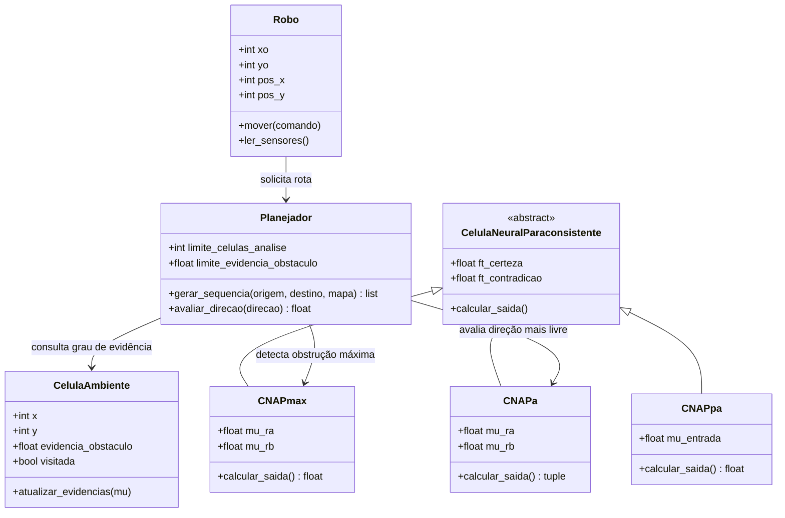

# Resumo Teórico e Glossário Técnico — Robô Móvel Paraconsistente

Este documento sintetiza a evolução teórica dos trabalhos que fundamentam a Iniciação Científica (Mestrado e Doutorado do Prof. Dr. Cláudio Rodrigo Torres), o glossário de termos essenciais da **Lógica Paraconsistente Anotada Evidencial $E\tau$** e a proposta de modelagem em **Programação Orientada a Objetos (POO)** para o robô virtual.

---

## 1. Visão Geral e Evolução do Projeto

O objetivo central da pesquisa é permitir que um **robô móvel autônomo** navegue em um ambiente não estruturado (com obstáculos) utilizando **Lógica Paraconsistente**.

Em ambientes reais ou simulados, os sensores que informam o robô sobre o mundo ao seu redor podem fornecer dados **incompletos, incertos ou contraditórios** (por exemplo, reflexos de ondas ultrassônicas onde um sensor acusa obstáculo e outro indica caminho livre). Em vez de falhar ou descartar informações conflitantes como na lógica clássica binária, a Lógica Paraconsistente permite que o sistema reconheça a contradição e tome decisões seguras a partir dela:
1. *"O que os sensores estão dizendo?"*
2. *"Quanto posso confiar nessas informações?"*
3. *"Existe um obstáculo nesta célula?"*
4. *"Qual movimento devo executar agora?"*

### Dissertação de Mestrado (2004) — Robô *Emmy II*
- **Foco:** Controle reativo e desvio de obstáculos com o controlador lógico paraconsistente **Paracontrol**.
- **Funcionamento:** Utiliza dois sensores ultrassônicos (gerando evidência favorável $\mu$ e evidência contrária $\lambda$ para a proposição *"A frente do robô está livre"*).
- **Inovação sobre o *Emmy I*:** Redução de 12 para **6 estados lógicos** de decisão, inclusão de **controle de velocidade** proporcional aos graus de certeza/incerteza e possibilidade de **movimentos retrógrados** (recuar ou girar acionando um motor para trás via ponte de MOSFETs).

### Tese de Doutorado (2010) — Sistema de Navegação (*Emmy III*)
- **Foco:** Ampliação do controle reativo para um sistema completo capaz de sair de uma **origem $(X_o, Y_o)$** e alcançar um **destino $(X_d, Y_d)$** desviando de obstáculos.
- **Divisão em 3 Subsistemas:**
  1. **Subsistema de Sensoriamento** (*"O que existe ao meu redor?"*): Divide o ambiente em uma grade de **células** e utiliza uma Rede Neural Artificial Paraconsistente (RNAP) composta por células `CNAPpa` e `CNAPa` para calcular e armazenar o grau de evidência favorável $\mu$ da proposição *"Existe obstáculo na célula"*.
  2. **Subsistema de Planejamento** (*"Qual caminho devo seguir?"*): Baseado em **Redes de Petri** e células neurais paraconsistentes (`CNAPmax` e `CNAPa`), consulta o mapa de células e gera uma **sequência numérica de movimentos** (de `1` a `8`) que contorna células obstruídas.
  3. **Subsistema Mecânico** (*"Como vou executar esse movimento?"*): Plataforma física ou virtual encarregada de executar a sequência de movimentos e atualizar a localização do robô.

### Escopo da Iniciação Científica
Estudar, simular e implementar os subsistemas de **sensoriamento, células neurais paraconsistentes e planejamento de rotas** em **ambiente virtual** (simulador gráfico 2D em Python/Tkinter e simulação 3D no **CoppeliaSim Edu**), estruturando o código com Programação Orientada a Objetos.

---

## 2. Glossário Técnico

| Termo / Símbolo | Definição |
| :--- | :--- |
| **Evidência Favorável ($\mu$)** | Grau real no intervalo $[0, 1]$ que expressa o quanto há de evidência a favor de uma proposição (ex.: *"Existe obstáculo na célula"* ou *"A frente está livre"*). |
| **Evidência Contrária ($\lambda$)** | Grau real no intervalo $[0, 1]$ que expressa o quanto há de evidência contrária à proposição analisada. |
| **Grau de Certeza ($G_c$)** | Calculado por $G_c = \mu - \lambda$, variando em $[-1, +1]$. Mede a distância até os estados extremos Verdadeiro ($+1$) ou Falso ($-1$). |
| **Grau de Contradição / Incerteza ($G_{ct}$)** | Calculado por $G_{ct} = (\mu + \lambda) - 1$, variando em $[-1, +1]$. Mede a tendência ao estado Inconsistente ($+1$) ou Paracompleto ($-1$). |
| **Grau de Evidência Resultante ($\mu_E$)** | Valor normalizado em $[0, 1]$ obtido a partir do grau de certeza: $\mu_E = \frac{\mu - \lambda + 1}{2}$. |
| **Para-analisador** | Algoritmo que recebe os graus de evidência $(\mu, \lambda)$, calcula os graus de certeza e incerteza e determina o **estado lógico** correspondente no reticulado. |
| **Paracontrol** | Controlador lógico paraconsistente que utiliza a saída do Para-analisador para comandar os atuadores (motores) do robô. |
| **Estados Lógicos (no *Emmy II*)** | **1. `V` (Verdadeiro):** $(1, 0)$ — Frente livre $\rightarrow$ avançar. **2. `F` (Falso):** $(0, 1)$ — Frente obstruída $\rightarrow$ recuar. **3. `⊥` (Paracompleto):** $(0, 0)$ — Falta de informação / lado direito mais livre $\rightarrow$ girar à direita para frente. **4. `T` (Inconsistente):** $(1, 1)$ — Contradição / lado esquerdo mais livre $\rightarrow$ girar à esquerda para frente. **5. `QF → ⊥` (Quase-Falso tendendo ao Paracompleto):** Girar à direita recuando. **6. `QF → T` (Quase-Falso tendendo ao Inconsistente):** Girar à esquerda recuando. |
| **Célula do Ambiente** | Cada unidade quadrada $(X, Y)$ em que o plano cartesiano do ambiente é discretizado. Pode estar livre, ocupada por obstáculo ou ocupada pelo robô, possuindo um grau de evidência $\mu \in [0, 1]$ de obstrução. |
| **NAP (Nó de Análise Paraconsistente)** | Unidade matemática de processamento paraconsistente que recebe evidências $(\mu, \lambda)$ e produz o Grau de Certeza Resultante Real ($G_{Crr}$) e o Intervalo de Evidência Resultante ($\varphi_E$). |
| **CNAPpa** | **Célula Neural Artificial Paraconsistente de Passagem:** Filtra/limita um grau de evidência de entrada $\mu$ com base no Fator de Tolerância à Certeza ($Ft_c$). |
| **CNAPa** | **Célula Neural Artificial Paraconsistente Analítica:** Recebe duas evidências $(\mu_{RA}, \mu_{RB})$ e fatores de tolerância ($Ft_{ct}, Ft_c$), calculando o grau de evidência resultante $\mu_E$ e o intervalo $\varphi_E$. |
| **CNAPmax** | **Célula Neural Artificial Paraconsistente de Maximização (Operador OU):** Recebe duas evidências $(\mu_{RA}, \mu_{RB})$ e seleciona o maior valor ($\mu_{\max}$) utilizando a equação fundamental da lógica paraconsistente. |
| **Planejador** | Módulo que consulta as evidências de obstrução das células vizinhas e gera a sequência de comandos numéricos (`1` a `8`) para levar o robô de $(X_o, Y_o)$ até $(X_d, Y_d)$. |
| **Atuador** | Componente físico ou virtual (motores/rodas) que executa o movimento determinado pelo controlador/planejador. |

---

## 3. Movimentação no Plano Cartesiano (8 Direções)

O ambiente do robô é mapeado como uma grade cartesiana 2D onde cada passo altera as coordenadas $(X, Y)$ em $\{-1, 0, +1\}$. Na tese de doutorado, no caderno `Sequencia_de_Comandos.pdf` e no simulador [`src/Interface_PlanejadorRobô2.py`](../src/Interface_PlanejadorRobô2.py), os **8 comandos de movimento** seguem o sentido horário a partir do eixo $+Y$:

| Comando | $\Delta X$ | $\Delta Y$ | Direção | Seta |
| :---: | :---: | :---: | :--- | :---: |
| **`1`** | `0` | `+1` | Cima | $\uparrow$ |
| **`2`** | `+1` | `+1` | Diagonal Superior Direita | $\nearrow$ |
| **`3`** | `+1` | `0` | Direita | $\rightarrow$ |
| **`4`** | `+1` | `-1` | Diagonal Inferior Direita | $\searrow$ |
| **`5`** | `0` | `-1` | Baixo | $\downarrow$ |
| **`6`** | `-1` | `-1` | Diagonal Inferior Esquerda | $\swarrow$ |
| **`7`** | `-1` | `0` | Esquerda | $\leftarrow$ |
| **`8`** | `-1` | `+1` | Diagonal Superior Esquerda | $\nwarrow$ |

> **Nota sobre as anotações manuscritas:** No arquivo `Movimento_Robo.pdf`, a figura da rosa dos ventos à direita exibe a numeração padrão acima (`1` = Cima, `3` = Direita, `5` = Baixo, `7` = Esquerda), mas a tabela escrita ao lado inverteu a listagem (`1` = Baixo, `5` = Cima). A convenção oficial adotada tanto na Tese de Doutorado (Capítulo 6, Figuras 6.3 a 6.10) quanto no código Python (`Interface_PlanejadorRobô2.py`) é a tabela acima (`1` = Cima).

---

## 4. Arquitetura em Programação Orientada a Objetos (POO)

Para organizar o código do robô virtual e integrar o sensoriamento, as redes neurais paraconsistentes e o planejador, a arquitetura do sistema é dividida em classes independentes:

